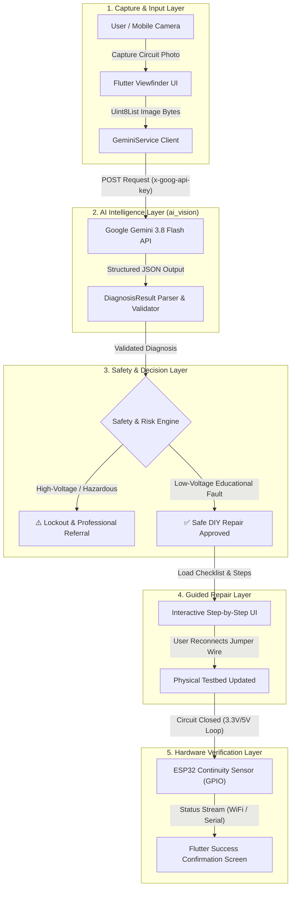

# 🛠️ FIXORA — AI-Powered Home Repair Assistant

<div align="center">

**“SEE IT. UNDERSTAND IT. FIX IT SAFELY.”**

*A multimodal AI & IoT assistant guiding homeowners through safe, intelligent circuit diagnostics and repair workflows.*

[](https://flutter.dev)
[](https://ai.google.dev/)
[](https://www.espressif.com/)
[](https://github.com/likhita007/FIXORA)

</div>

---

## 📌 1. Project Overview

**FIXORA** is an intelligent, safety-first home repair diagnostic system developed for B.Tech Engineering Clinics. It bridges the gap between complex electrical/hardware troubleshooting and non-expert homeowners by combining:
1. **Multimodal Computer Vision** (Google Gemini 3.8 Flash) to inspect circuit anomalies visually.
2. **Safety & Risk Classification Engine** to evaluate hazards and prevent dangerous DIY actions on high-voltage systems.
3. **Step-by-Step Interactive Repair Guidance** to provide clear, foolproof repair procedures.
4. **IoT Hardware Continuity Testbed** (ESP32) to physically verify circuit restoration in real time.

---

## 🔄 2. End-to-End System Workflow



---

## 🧩 3. Core Modules & Specifications

| # | Module Name | Primary Role | Tech Stack | Input / Output |
|:---:|:---|:---|:---|:---|
| **1** | **Mobile Client UI** | Camera capture viewfinder, diagnosis card presentation, interactive checklist UI | Flutter / Dart | **Input:** Camera stream<br>**Output:** Raw image bytes & UI state |
| **2** | **AI Vision & Diagnosis** | Multimodal circuit anomaly detection & structured JSON schema generation | Google Gemini `gemini-3.8-flash`, `http` | **Input:** `Uint8List` image bytes<br>**Output:** Strongly typed `DiagnosisResult` |
| **3** | **Safety & Risk Engine** | Hazard scoring, DIY vs. Professional lockout enforcement, PPE checklists | Dart Rule Engine | **Input:** `DiagnosisResult`<br>**Output:** Safety clearance status |
| **4** | **Step-by-Step Guidance** | Dynamic visual repair walkthrough with safety gates | Flutter State Machine | **Input:** Fault type + Component location<br>**Output:** Visual instructions |
| **5** | **ESP32 Physical Testbed** | Low-voltage continuity sensing & real-time physical confirmation | ESP32, C++ (Arduino IDE), Breadboard | **Input:** Closed loop on GPIO pin<br>**Output:** Continuity status stream |

---

## 📸 4. Detailed Module-by-Module Breakdown

### 📱 Module 1: Flutter Mobile Client
- **Camera Module**: Captures high-resolution frames of educational circuits with auto-focus and illumination warnings.
- **State Management**: Reactive state management handling diagnosis loading, error recovery, and hardware status streams.
- **Fail-Safe UI**: Displays instant visual badges (`SUCCESS`, `UNKNOWN`, `ERROR`) and clamps confidence indicators.

### 🧠 Module 2: AI Vision & Diagnosis (`ai_vision/`)
- **Direct Gemini REST Client**: Communicates via standard `http` package with Google Gemini v1beta endpoint using `x-goog-api-key` header authentication.
- **Model**: `gemini-3.8-flash` with `response_mime_type: application/json`.
- **Domain Model**: `DiagnosisResult` ensures sanitized parsing, bounding confidence between `0.0` and `1.0`.
- **Zero API Key Leakage**: Keys are passed at compile time via `--dart-define=GEMINI_API_KEY=...`.

```json
{
  "status": "SUCCESS",
  "fault_detected": true,
  "fault_type": "DISCONNECTED_WIRE",
  "location": "Jumper wire connection between switch and breadboard terminal",
  "possible_cause": "The jumper wire appears disconnected or unseated, resulting in an open circuit.",
  "confidence": 0.92
}
```

### 🛡️ Module 3: Safety & Risk Engine
- **Pre-Diagnostic Safety Checks**: Inspects image classification for AC mains or high-voltage lines.
- **Automatic Lockout**: If AC mains or hazardous voltage is suspected, immediately triggers an emergency warning and directs the user to certified technicians.
- **Mandatory Safety Protocols**: Low-voltage repair workflows require users to toggle the power switch off before touching breadboard jumpers.

### 📋 Module 4: Dynamic Repair Guidance
1. **Preparation**: Display tools needed (e.g., standard male-to-male jumper wire).
2. **Safety Check**: Confirm circuit switch is open/off.
3. **Target Action**: Re-seat the disconnected jumper wire into the specified breadboard row.
4. **Power Restoration**: Switch circuit power back on and observe LED state.

### ⚡ Module 5: ESP32 Hardware Verification Testbed
- **Testbed Setup**: ESP32 Microcontroller, Solderless Breadboard, Toggle Switch, 220Ω Resistor, 5V LED, and Jumper Wires.
- **Continuity Verification**: ESP32 reads digital logic state on designated GPIO pins.
- When the disconnected jumper is replaced, the continuity loop closes, sending an instant confirmation signal back to the Flutter app.

---

## 🔬 5. Review-II Primary Demonstration Flow

```text
[ Step 1: Fault State ]
  Breadboard jumper wire between switch and resistor is intentionally unplugged.
  Circuit LED is OFF.
        │
        ▼
[ Step 2: AI Image Capture ]
  User opens FIXORA app and snaps a photo of the breadboard.
        │
        ▼
[ Step 3: Gemini Vision Diagnosis ]
  Gemini 3.8 Flash analyzes image and returns:
  fault_detected: true, fault_type: "DISCONNECTED_WIRE"
        │
        ▼
[ Step 4: Safety & Repair Guidance ]
  App verifies low-voltage status and displays step-by-step reconnect instructions.
        │
        ▼
[ Step 5: User Fix & Physical Sensing ]
  User re-inserts jumper wire. ESP32 detects circuit continuity.
  LED turns ON + App displays "Circuit Verified Successfully!".
```

---

## 📂 6. Repository Structure

```text
FIXORA/
├── README.md                  # Comprehensive project & multi-module workflow guide
└── ai_vision/                 # Module 2: AI Multimodal Diagnosis
    ├── README.md              # AI Vision integration guide & usage examples
    ├── sample_diagnosis.json  # Validated test payloads (Fault, Normal, Blurry)
    ├── gemini_service.dart    # Dart service & DiagnosisResult domain model
    └── prompts.txt            # System prompt & structured JSON schema
```

---

## 🚀 7. Quickstart & Integration

### Prerequisites
- Flutter SDK `^3.0.0`
- Dart SDK `^3.0.0`
- Google AI Studio Gemini API Key

### Running the App with AI Vision
```bash
# 1. Clone repository
git clone https://github.com/likhita007/FIXORA.git
cd FIXORA

# 2. Install dependencies
flutter pub get

# 3. Run application with secure compile-time API key
flutter run --dart-define=GEMINI_API_KEY=YOUR_GEMINI_API_KEY_HERE
```

---

## 👥 8. Engineering Clinics Team & Roles

*   **AI Vision & Multimodal Module**: Prompt engineering, Gemini 3.8 Flash REST client, JSON contract model (`ai_vision/`).
*   **Flutter Mobile App**: UI/UX design, camera integration, reactive state management.
*   **Safety & Guidance System**: Risk decision engine and interactive troubleshooting checklists.
*   **IoT & Hardware Integration**: ESP32 firmware, circuit testbed assembly, continuity sensing.

---

<div align="center">
<b>FIXORA — Engineering Clinics Project</b><br>
<i>See It. Understand It. Fix It Safely.</i>
</div>
